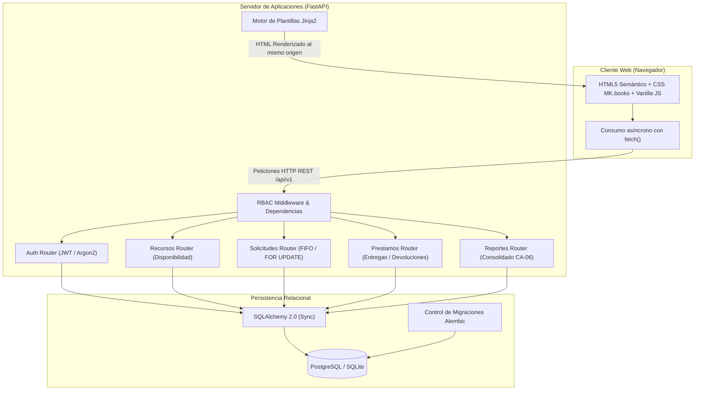
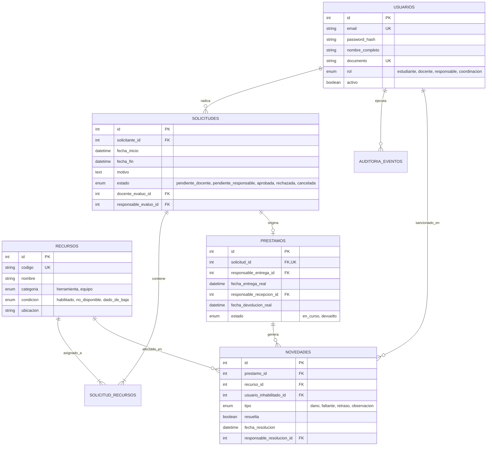

# Guía de Trabajo Práctico Experimental — Proyecto Final (PF-03)
## Sistema de Préstamos de Herramientas y Equipos — MK.books

---

## 1. Información General

| Campo | Detalle |
| :--- | :--- |
| **Nombre del Proyecto** | Sistema de Préstamos de Herramientas y Equipos (MK.books) |
| **Problema Seleccionado** | Gestión integral del ciclo de vida de préstamos de recursos académicos (PF-03) |
| **Asignatura** | Aplicaciones y Servicios Web |
| **Programa Académico** | Tecnología en Desarrollo de Software |
| **Docente Evaluador** | Juan Carlos Morales Guerra |
| **Integrantes y Contribución** | • **Paulina Trejos** (50%): Arquitectura backend, modelos ORM, seguridad JWT/Argon2, catálogo de recursos, validación de fechas `[inicio, fin)`, flujo de evaluación FIFO y diseño frontend editorial.<br>• **Ronald Cardona** (50%): Gestión de entregas y devoluciones, reglas de inhabilitación por daño/mora, módulo de reportes consolidados para Coordinación, pruebas funcionales y documentación. |
| **Fecha de Presentación** | Noviembre de 2026 |
| **Repositorio Oficial en GitHub** | [https://github.com/lintrejoss/Proyecto_Final](https://github.com/lintrejoss/Proyecto_Final) |

---

## 2. Descripción del Sistema

### A. Problema Abordado
Una institución educativa presta herramientas y equipos especializados a estudiantes y docentes para prácticas de laboratorio. El proceso manual previo presentaba dificultades críticas: imposibilidad de consultar disponibilidad en tiempo real, colisiones en solicitudes simultáneas para los mismos equipos, falta de trazabilidad en las autorizaciones académicas, descontrol en devoluciones con daños o faltantes, y ausencia de información consolidada para la toma de decisiones directivas.

### B. Actores Involucrados
1. **Estudiante:** Consulta catálogo, verifica disponibilidad y radica solicitudes que requieren visto bueno docente previo.
2. **Docente:** Radica solicitudes directas para su labor académica y actúa como evaluador de solicitudes de sus estudiantes.
3. **Responsable de Laboratorio:** Administra recursos, aplica regla de llegada FIFO, aprueba reservas firmes, formaliza entregas físicas, recibe devoluciones, registra novedades y gestiona rehabilitaciones.
4. **Coordinación:** Monitorea indicadores clave (KPIs), recursos más solicitados, morosidad institucional y auditoría de eventos.

### C. Alcance Aprobado y Restricciones
- **Ciclo Completo Implementado:** Consulta de disponibilidad → solicitud → evaluación → reserva firme → entrega física → seguimiento de mora → devolución física → novedades e inhabilitación → historial y reportes consolidados.
- **Límites Obligatorios (Conforme a la Guía PF-03):** El sistema se delimita estrictamente al proceso de préstamo. No incluye escaneo QR/RFID, facturación o multas económicas, envíos de correo/WhatsApp por servicios de terceros, ni mantenimiento de hardware.
- Documento de especificación detallado en: [`docs/requisitos.md`](docs/requisitos.md).

---

## 3. Requisitos y Alcance

### A. Método de Obtención y Entrevista con el Docente
Los requisitos se estructuraron a partir del documento de trabajo práctico y la sesión de aclaraciones con el docente (representante organizacional), distinguiendo tres jerarquías normativas:
- **[A] Obligaciones de la Guía:** Persistencia relacional, API REST, RBAC, interfaz responsiva y pruebas documentadas.
- **[B] Respuestas Confirmadas por el Docente (Prevalecen sobre el borrador):**
  1. *Fechas Futuras:* Se permiten reservas para fechas futuras sin límite artificial de 24 horas.
  2. *Aval Docente:* Todo préstamo a estudiante requiere aprobación previa de un docente.
  3. *Orden Estricto (FIFO):* Las solicitudes se procesan estrictamente por orden de llegada; solicitudes posteriores no pueden adelantarse si compiten por los mismos recursos.
  4. *Bloqueo por Mora (RN-06):* Si un usuario tiene un préstamo vencido no devuelto, no puede recibir nuevas entregas.
  5. *Inhabilitación por Daño o Faltante (RN-07):* Si devuelve un recurso con avería o incompleto, queda inhabilitado hasta resolver el caso.
- **[C] Decisiones Propuestas por el Equipo (ADR):** Intervalos semiabiertos `[inicio, fin)`, control de concurrencia pesimista (`SELECT ... FOR UPDATE`), y marca institucional MK.books. Registradas en [`docs/decisiones.md`](docs/decisiones.md).

### B. Condiciones de Aceptación Obligatorias (CA)

| ID | Condición | Demostración en la Aplicación |
| :--- | :--- | :--- |
| **CA-01** | Disponibilidad coherente de recursos | Catálogo (`/catalogo`) calcula disponibilidad temporal con fórmula semiabierta `inicioA < finB && inicioB < finA`. |
| **CA-02** | Solicitud persistente y recuperable | Solicitante radica solicitudes en base de datos (`/solicitudes`) y puede cancelarlas antes de la entrega física. |
| **CA-03** | Evaluación y gestión autorizada | Visto bueno docente (`/docente/bandeja`) y aprobación responsable (`/responsable/bandeja`) con motivo obligatorio en caso de rechazo. |
| **CA-04** | Asignación y entrega sin conflictos | Bloqueo pesimista `FOR UPDATE` en BD, registro de entrega física (`/responsable/prestamos`) y bloqueo por préstamos vencidos [RN-06]. |
| **CA-05** | Devolución, historial y novedades | Retorno formal (`/responsable/prestamos`); reporte de daño o faltante crea `Novedad`, pasa recurso a `no_disponible` e inhabilita al usuario [RN-07]. |
| **CA-06** | Consulta consolidada de coordinación | Panel gerencial (`/reportes/consolidado`) con KPIs en tiempo real, filtros dinámicos (fechas, estado, categoría) y auditoría. |

---

## 4. Arquitectura, Diseño de API y Modelo de Datos

### A. Diagrama de Arquitectura Cliente-Servidor


### B. Modelo Entidad-Relación de la Base de Datos


### C. Justificación de Tecnologías
- **FastAPI + Pydantic v2:** Alto rendimiento, tipado estricto, documentación OpenAPI/Swagger automática y serialización transparente.
- **SQLAlchemy 2.0 síncrono:** Mapeo relacional confiable con control transaccional explícito y bloqueos pesimistas deterministas.
- **Alembic:** Versionamiento riguroso del esquema de base de datos (`alembic/versions/`).
- **Argon2id + JWT:** Hashing moderno resistente a ataques GPU/ASIC y autenticación Bearer transportada en cookies HttpOnly seguras.
- **Frontend Ligero (Sin frameworks):** Respeta la directriz de la guía de no incorporar complejidad accidental innecesaria (sin Node, npm o Webpack).
- Diagramas y arquitectura completa en: [`docs/diseno.md`](docs/diseno.md).

---

## 5. Configuración del Entorno y Despliegue Local

### A. Prerrequisitos
- Python 3.9 o superior instalado.
- Git instalado.
- Sistema Operativo: Windows, macOS o Linux.

### B. Pasos de Instalación y Ejecución

```bash
# 1. Clonar el repositorio
git clone https://github.com/lintrejoss/Proyecto_Final.git
cd Proyecto_Final

# 2. Crear y activar el entorno virtual
python3 -m venv .venv
source .venv/bin/activate       # En macOS / Linux
# .venv\Scripts\activate       # En Windows

# 3. Instalar dependencias reproducibles
pip install -r requirements.txt

# 4. Configurar variables de entorno seguras (template sin secretos reales)
cp .env.example .env

# 5. Ejecutar migraciones o carga inicial de datos semilla
python scripts/seed_data.py

# 6. Iniciar el servidor web de desarrollo
uvicorn src.main:app --reload --port 8000
```

Acceso a la plataforma:
- **Aplicación Web:** [http://localhost:8000](http://localhost:8000)
- **Documentación Swagger UI:** [http://localhost:8000/docs](http://localhost:8000/docs)

### C. Cuentas de Acceso para Demostración

| Perfil | Correo Electrónico | Contraseña | Nombre Completo | Documento |
| :--- | :--- | :--- | :--- | :--- |
| **Estudiante 1** | `estudiante@universidad.edu.co` | `Estudiante123!` | Paulina Trejos | `EST-2026-001` |
| **Estudiante 2** | `estudiante2@universidad.edu.co` | `Estudiante2123!` | Ronald Cardona | `EST-2026-002` |
| **Docente** | `docente@universidad.edu.co` | `Docente123!` | Prof. Carlos Ruiz | `DOC-1082-993` |
| **Responsable** | `responsable@universidad.edu.co` | `Responsable123!` | Marta Gómez (Lab) | `LAB-0045-812` |
| **Coordinación** | `coordinacion@universidad.edu.co` | `Coordinacion123!` | Dr. Fernando Ospina | `CRD-0012-745` |

*(El formulario de inicio de sesión dispone de botones de carga automática para agilizar la sustentación).*

---

## 6. Servicios Web Implementados

Tabla consolidada de endpoints de la API REST (`/api/v1`):

| Método | Ruta | Descripción | Rol Mínimo | Requisito Relacionado |
| :--- | :--- | :--- | :--- | :--- |
| `POST` | `/api/v1/auth/login` | Autentica usuario y emite JWT en cuerpo y cookie | Público | RF-01 |
| `GET` | `/api/v1/auth/me` | Obtiene el perfil del usuario autenticado | Autenticado | RF-01, RNF-01 |
| `GET` | `/api/v1/recursos` | Lista catálogo de herramientas y equipos | Autenticado | CA-01 |
| `GET` | `/api/v1/recursos/{id}/disponibilidad` | Consulta disponibilidad temporal por rango `[inicio, fin)` | Autenticado | CA-01, RN-01 |
| `POST` | `/api/v1/solicitudes` | Radica solicitud de préstamo persistente | Estudiante, Docente | CA-02, RF-03 |
| `GET` | `/api/v1/solicitudes` | Lista solicitudes según el rol del usuario | Autenticado | CA-02, RF-04 |
| `POST` | `/api/v1/solicitudes/{id}/cancelar` | Cancela solicitud antes de la entrega | Solicitante | RN-09, RF-04 |
| `GET` | `/api/v1/solicitudes/bandeja/docente` | Lista solicitudes de estudiantes pendientes de aval | Docente | CA-03, RF-05, RN-02 |
| `POST` | `/api/v1/solicitudes/{id}/evaluar-docente` | Emite visto bueno o rechazo docente con motivo | Docente | CA-03, RF-05 |
| `GET` | `/api/v1/solicitudes/bandeja/responsable` | Lista solicitudes pendientes con orden FIFO | Responsable | CA-03, RF-06, RN-05 |
| `POST` | `/api/v1/solicitudes/{id}/evaluar-responsable` | Aprueba y reserva firmemente o rechaza | Responsable | CA-03, RF-06, RN-04 |
| `GET` | `/api/v1/prestamos/listas-para-entrega` | Lista solicitudes aprobadas pendientes de despacho | Responsable | CA-04, RF-07 |
| `POST` | `/api/v1/prestamos/entregar` | Formaliza entrega física y bloquea morosos | Responsable | CA-04, RF-07, RN-06 |
| `POST` | `/api/v1/prestamos/{id}/devolver` | Registra retorno y evalúa novedades por ítem | Responsable | CA-05, RF-08, RN-07 |
| `GET` | `/api/v1/prestamos` | Lista préstamos activos e históricos con estado de mora | Responsable, Coordinación | RF-11 |
| `GET` | `/api/v1/prestamos/mis-prestamos` | Historial de préstamos propios | Estudiante, Docente | CA-05 |
| `GET` | `/api/v1/novedades` | Lista novedades físicas y usuarios inhabilitados | Responsable, Coordinación | RF-09 |
| `POST` | `/api/v1/novedades/{id}/resolver` | Resuelve caso, rehabilita equipo y usuario | Responsable, Coordinación | RN-08, RF-09 |
| `GET` | `/api/v1/reportes/metricas` | KPIs cuantitativos en tiempo real para Coordinación | Coordinación, Responsable | CA-06, RF-12 |
| `GET` | `/api/v1/reportes/consolidado` | Consulta consolidada con filtros por fecha y estado | Coordinación, Responsable | CA-06, RF-12 |

Ejemplos de consumo HTTP y respuestas de error documentados en: [`evidencias/endpoints_operacion.md`](evidencias/endpoints_operacion.md).

---

## 7. Pruebas de API e Integración y Evidencias de Funcionamiento

El proyecto implementa una suite de **30 pruebas automatizadas** con `pytest` que verifican de extremo a extremo las reglas de negocio, la integridad de la base de datos y la seguridad:

```bash
# Ejecutar todas las 30 pruebas automatizadas
pytest tests/ -v
```

### Resumen de Pruebas por Etapa:
- **Etapa 1 — Autenticación y RBAC (`tests/test_etapa1_auth.py`):** 7 pruebas (Healthcheck, Argon2id, Login exitoso en 4 roles, credenciales inválidas, sesión JWT y protección de vistas).
- **Etapa 2 — Catálogo y Solicitudes (`tests/test_etapa2_recursos_solicitudes.py`):** 6 pruebas (Catálogo, cálculo temporal `[inicio, fin)`, solicitud estudiante, solicitud docente directa, validación de fechas pasadas y cancelación).
- **Etapa 3 — Visto Bueno, FIFO y Concurrencia (`tests/test_etapa3_evaluacion_fifo_concurrencia.py`):** 5 pruebas (Visto bueno docente, rechazo con motivo, reserva firme, regla estricta de orden de llegada FIFO y bloqueo por condición `no_disponible`).
- **Etapa 4 — Entregas, Vencidos y Novedades (`tests/test_etapa4_prestamos_novedades.py`):** 5 pruebas (Entrega física, bloqueo por préstamo vencido [RN-06], devolución conforme, reporte de daño e inhabilitación [RN-07] y rehabilitación condicionada [RN-08]).
- **Etapa 5 — Reportes de Coordinación (`tests/test_etapa5_reportes_coordinacion.py`):** 7 pruebas (Restricción RBAC de reportes, vistas web gerenciales, concordancia exacta de métricas con BD, filtros por estado/categoría, filtros por rango de fechas, trazabilidad de morosidad y auditoría).

**Evidencias reproducibles:**
- Salida completa de consola de pruebas: [`evidencias/pruebas_pytest.txt`](evidencias/pruebas_pytest.txt).
- Matriz detallada de casos de prueba: [`docs/pruebas.md`](docs/pruebas.md).
- Matriz de trazabilidad Requisitos vs. Código vs. Pruebas: [`docs/trazabilidad.md`](docs/trazabilidad.md).

---

## 8. Control de Versiones y Trabajo Colaborativo

El proyecto aplicó la estrategia de ramificación **Git Feature Branch Workflow** articulada con la guía docente. El desarrollo se organizó por etapas verificables y cada entrega contó con su respectivo Pull Request hacia `main`:

```text
  main ──────────────┬──────────────────┬──────────────────┬──────────────────► [v1.0 Entrega Final]
                     ▲                  ▲                  ▲                  ▲
                     │ (PR #1)          │ (PR #2)          │ (PR #3)          │
       etapa-1-auth ─┘    etapa-3-fifo ─┘    etapa-4-prest ┘    etapa-5-rep ──┘
```

### Ramas Oficiales en GitHub:
1. `etapa-1-autenticacion`: Esqueleto monolítico, modelos SQLAlchemy, migraciones Alembic, auth Argon2id/JWT.
2. `etapa-2-catalogo-solicitudes`: Catálogo, cálculo de disponibilidad temporal `[inicio, fin)` y persistencia de solicitudes.
3. `etapa-3-evaluacion-fifo`: Flujo de aval docente, aprobación de responsable con reservas firmes, regla FIFO y concurrencia `FOR UPDATE`.
4. `etapa-4-prestamos-novedades`: Entrega física, control de mora [RN-06], devoluciones, novedades [RN-07] y rehabilitación [RN-08].
5. `etapa-5-reportes-coordinacion`: Consulta consolidada gerencial, cálculo dinámico de KPIs y filtros para Coordinación (CA-06).
6. `main`: Integración oficial estable con todas las pruebas en verde.

### Resumen Verificable de Aportes del Equipo:
- **Paulina Trejos:** Configuración del repositorio y entorno, modelos iniciales ORM y migraciones Alembic, arquitectura de autenticación JWT y roles RBAC, servicio de cálculo de disponibilidad por fechas sin límite de 24 horas, motor de evaluación de solicitudes con bloqueo pesimista y orden estricto de llegada (FIFO), diseño visual editorial del frontend bajo la marca MK.books.
- **Ronald Cardona:** Implementación del flujo de entregas físicas de préstamos, servicio de cálculo dinámico de préstamos vencidos e inhabilitación por mora [RN-06], motor de recepción de devoluciones con reporte de novedades físicas (daño/faltante) [RN-07], endpoints y vistas de resolución de casos [RN-08], panel de consulta consolidada y métricas para Coordinación (CA-06), suite de pruebas automatizadas de las etapas 4 y 5 y elaboración de evidencias.

---

## 9. Conclusiones y Limitaciones

### A. Cumplimiento de Condiciones
- Se demostró el **ciclo completo de vida de los préstamos universitarios** (no un CRUD estático), integrando realmente frontend nativo, API REST y persistencia relacional bajo un solo origen.
- Se respetaron al 100% las decisiones confirmadas por el docente: eliminación del límite de 24 horas, obligatoriedad del visto bueno docente para estudiantes, atención estricta por orden de llegada (FIFO), bloqueo de entregas por préstamos vencidos y régimen de inhabilitación por daños físicos.

### B. Retos Técnicos Resueltos
1. **Concurrencia Pesimista:** Para evitar condiciones de carrera donde dos responsables aprobaran solicitudes simultáneas sobre los mismos recursos, se implementó bloqueo pesimista a nivel de fila (`SELECT ... FOR UPDATE`) ordenando los IDs de forma determinista para prevenir interbloqueos (*deadlocks*).
2. **Disponibilidad Temporal Continua:** Se separó la condición operativa del recurso (`habilitado`, `no_disponible`, `dado_de_baja`) de su ocupación temporal, permitiendo que un equipo prestado hoy pueda reservarse válidamente para la próxima semana.
3. **Detección Dinámica de Mora:** Se calculan los préstamos vencidos directamente a partir de las fechas pactadas y la hora actual (`ahora > fecha_fin`), garantizando que la regla [RN-06] opere en tiempo real sin requerir demonios o tareas en segundo plano complejas (Celery/Cron).

### C. Restricciones Pendientes para Fases Futuras
- El sistema no maneja préstamos con devoluciones parciales (para este MVP la entrega y la devolución se realizan en bloque para la solicitud completa).
- No se contemplan tiempos muertos automáticos de preparación o calibración entre préstamos contiguos.
