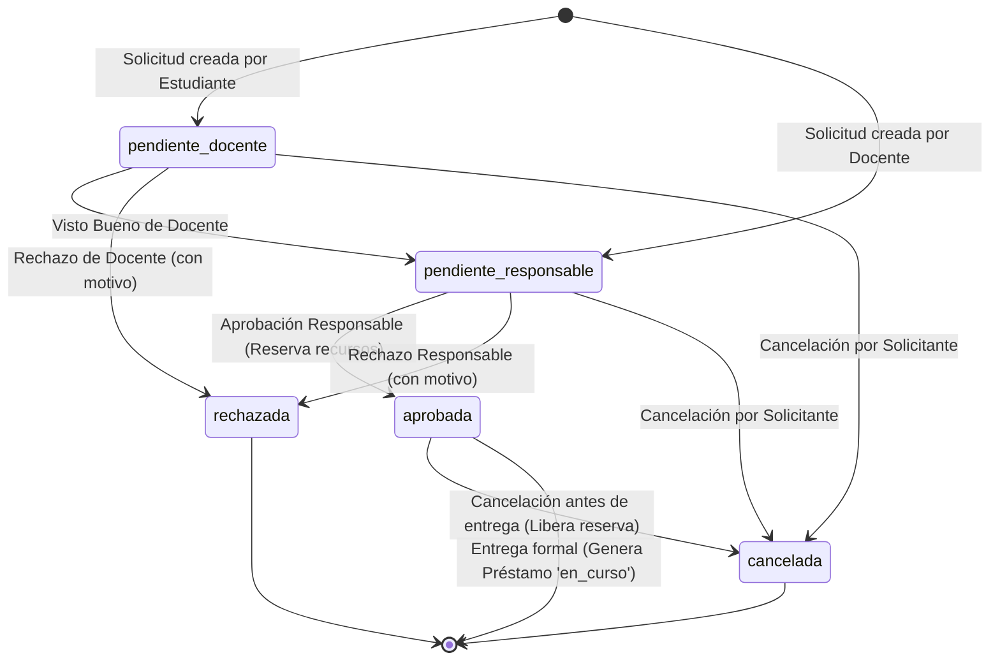
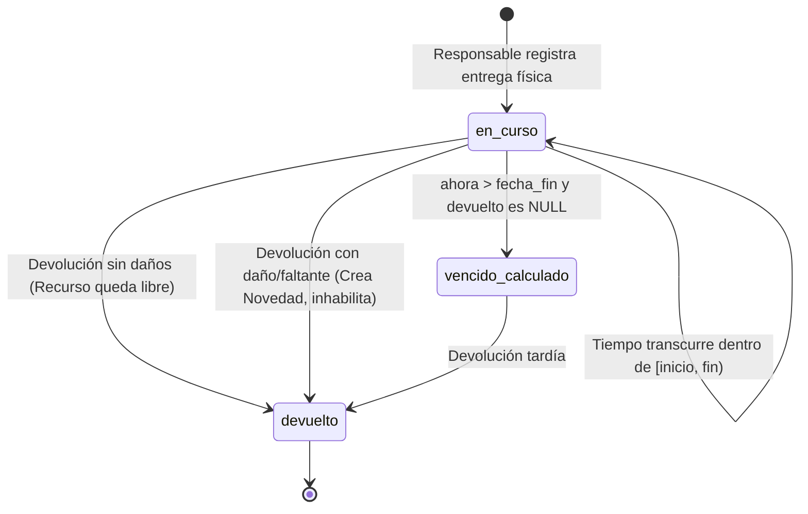

# Documento de Diseño Arquitectural y de Datos

Este documento detalla la arquitectura de software, el modelo entidad-relación, las máquinas de estado y los mecanismos de integridad transaccional del **Sistema de Préstamos de Herramientas y Equipos**.

---

## 1. Arquitectura del Sistema

El sistema sigue un patrón **Monolítico Modular**:
- **Capa Web / Interfaz**: Servida directamente por FastAPI usando Jinja2 para renderizar plantillas HTML5 base, complementada con Vanilla JavaScript (`fetch`) para interactuar con la API REST de forma asíncrona y reactiva.
- **Capa de Controladores (Routers)**: Rutas HTTP organizadas por dominio (`/auth`, `/api/v1/recursos`, `/api/v1/solicitudes`, `/api/v1/prestamos`, `/api/v1/novedades`, `/api/v1/reportes`).
- **Capa de Servicios**: Encapsula las reglas de negocio complejas (evaluación de superposiciones, bloqueo pesimista en orden estable, cálculo de vencimientos e inhabilitaciones).
- **Capa de Acceso a Datos / Persistencia**: Modelos declarativos con SQLAlchemy 2.0 y migraciones versionadas con Alembic sobre PostgreSQL.

```
+--------------------------------------------------------------------+
|                    Navegador Web (Cliente)                         |
|   HTML5 + CSS Moderno + Vanilla JS (fetch API, Token JWT en Header)|
+---------------------------------+----------------------------------+
                                  | HTTP / JSON / HTML
+---------------------------------v----------------------------------+
|                   FastAPI Monolito (Backend)                       |
|  +--------------------+  +---------------------------------------+ |
|  | Rutas HTML (Jinja2)|  | Rutas API REST (/api/v1/...)          | |
|  +--------------------+  +---------------------------------------+ |
|                             |                                      |
|                 +-----------v-----------+                          |
|                 | Capa de Seguridad RBAC|                          |
|                 | (JWT, Argon2, Roles)  |                          |
|                 +-----------+-----------+                          |
|                             |                                      |
|                 +-----------v-----------+                          |
|                 |   Capa de Servicios   |                          |
|                 | (Lógica & Concurrencia)|                         |
|                 +-----------+-----------+                          |
|                             |                                      |
|                 +-----------v-----------+                          |
|                 |    Modelos ORM        |                          |
|                 |    (SQLAlchemy 2.0)   |                          |
|                 +-----------+-----------+                          |
+-----------------------------|--------------------------------------+
                              | SQL / Transacciones ACID
+-----------------------------v--------------------------------------+
|                     PostgreSQL Database                            |
+--------------------------------------------------------------------+
```

---

## 2. Modelo de Datos y Relaciones

### 2.1 Entidades Principales

1. **`usuarios`**:
   - `id`: Entero autoincremental (PK).
   - `email`: VARCHAR(255), único, no nulo.
   - `password_hash`: VARCHAR(255), hash con Argon2.
   - `nombre_completo`: VARCHAR(255), no nulo.
   - `documento`: VARCHAR(50), no nulo, identificador institucional único.
   - `rol`: ENUM (`estudiante`, `docente`, `responsable`, `coordinacion`).
   - `activo`: BOOLEAN, por defecto True.
   - `creado_en`: TIMESTAMP con zona horaria (UTC).

2. **`recursos`**:
   - `id`: Entero autoincremental (PK).
   - `codigo`: VARCHAR(50), único, no nulo (ej. `HER-001`, `EQP-010`).
   - `nombre`: VARCHAR(200), no nulo.
   - `categoria`: ENUM (`herramienta`, `equipo`).
   - `marca`: VARCHAR(100), opcional.
   - `modelo`: VARCHAR(100), opcional.
   - `serie`: VARCHAR(100), opcional.
   - `condicion`: ENUM (`habilitado`, `no_disponible`, `dado_de_baja`).
   - `ubicacion`: VARCHAR(150), no nulo.
   - `creado_en`: TIMESTAMP con zona horaria (UTC).

3. **`solicitudes`**:
   - `id`: Entero autoincremental (PK).
   - `solicitante_id`: FK a `usuarios.id`, no nulo.
   - `fecha_inicio`: TIMESTAMP con zona horaria, inicio del período $[inicio, fin)$.
   - `fecha_fin`: TIMESTAMP con zona horaria, fin del período.
   - `motivo`: TEXT, justificación académica del préstamo.
   - `estado`: ENUM (`pendiente_docente`, `pendiente_responsable`, `aprobada`, `rechazada`, `cancelada`).
   - `motivo_rechazo`: TEXT, obligatorio al rechazar.
   - `motivo_cancelacion`: TEXT, obligatorio al cancelar.
   - `docente_evaluo_id`: FK a `usuarios.id`, nullable.
   - `fecha_evaluacion_docente`: TIMESTAMP con zona horaria, nullable.
   - `responsable_evaluo_id`: FK a `usuarios.id`, nullable.
   - `fecha_evaluacion_responsable`: TIMESTAMP con zona horaria, nullable.
   - `creado_en`: TIMESTAMP con zona horaria (determina orden FIFO).

4. **`solicitud_recursos`** (Tabla de asociación N:M):
   - `solicitud_id`: FK a `solicitudes.id` ON DELETE CASCADE.
   - `recurso_id`: FK a `recursos.id` ON DELETE RESTRICT.
   - Restricción PK compuesta: `(solicitud_id, recurso_id)`.

5. **`prestamos`**:
   - `id`: Entero autoincremental (PK).
   - `solicitud_id`: FK a `solicitudes.id` UNIQUE (1:1 con solicitud).
   - `responsable_entrega_id`: FK a `usuarios.id`, no nulo.
   - `fecha_entrega_real`: TIMESTAMP con zona horaria, instante en que se entregan los ítems.
   - `observaciones_entrega`: TEXT.
   - `responsable_recepcion_id`: FK a `usuarios.id`, nullable.
   - `fecha_devolucion_real`: TIMESTAMP con zona horaria, nullable.
   - `observaciones_devolucion`: TEXT, nullable.
   - `estado`: ENUM (`en_curso`, `devuelto`). *(Nota: La condición de `vencido` se calcula dinámicamente si `fecha_devolucion_real IS NULL` y `ahora > solicitud.fecha_fin`)*.

6. **`novedades`**:
   - `id`: Entero autoincremental (PK).
   - `prestamo_id`: FK a `prestamos.id`, no nulo.
   - `recurso_id`: FK a `recursos.id`, no nulo.
   - `usuario_inhabilitado_id`: FK a `usuarios.id`, usuario sobre el cual recae la sanción.
   - `tipo`: ENUM (`dano`, `faltante`, `retraso`, `observacion`).
   - `descripcion`: TEXT, detalle de la anomalía física.
   - `resuelta`: BOOLEAN, por defecto False.
   - `fecha_resolucion`: TIMESTAMP con zona horaria, nullable.
   - `responsable_resolucion_id`: FK a `usuarios.id`, nullable.
   - `observaciones_resolucion`: TEXT, nullable.
   - `creado_en`: TIMESTAMP con zona horaria.

7. **`auditoria_eventos`**:
   - `id`: Entero autoincremental (PK).
   - `usuario_id`: FK a `usuarios.id`, nullable.
   - `accion`: VARCHAR(100), ej. `CREACION_SOLICITUD`, `VISTO_BUENO_DOCENTE`, `APROBACION_RESPONSABLE`, `ENTREGA_PRESTAMO`, `DEVOLUCION_PRESTAMO`, `RESOLUCION_NOVEDAD`.
   - `entidad`: VARCHAR(50), ej. `solicitud`, `prestamo`, `recurso`, `novedad`.
   - `entidad_id`: INT, nullable.
   - `detalles`: JSON / TEXT.
   - `creado_en`: TIMESTAMP con zona horaria.

---

## 3. Máquinas de Estado

### 3.1 Ciclo de Vida de la Solicitud



### 3.2 Ciclo de Vida del Préstamo



### 3.3 Ciclo de Condición Operativa del Recurso vs Disponibilidad

- **Condición Operativa**:
  - `habilitado`: Apto físicamente para ser prestado.
  - `no_disponible`: Retirado temporalmente por daño, faltante o mantenimiento.
  - `dado_de_baja`: Desincorporado permanentemente del inventario institucional.

- **Disponibilidad por Fechas $[T_1, T_2)$**:
  - Un recurso está disponible en $[T_1, T_2)$ si y solo si:
    1. Su condición operativa es `habilitado`.
    2. No existe ninguna solicitud en estado `aprobada` o préstamo asociado cuyos rangos colisionen con $[T_1, T_2)$.
    3. Si actualmente está prestado y no ha sido devuelto a pesar de haber vencido su período original, no puede ser entregado a la siguiente reserva hasta su retorno.

---

## 4. Estrategia de Concurrencia e Integridad Transaccional

Para evitar condiciones de carrera (Race Conditions) donde dos administradores intenten aprobar simultáneamente dos solicitudes que disputan el mismo equipo para horas coincidentes:

1. **Transacción Única**: Toda la operación de evaluación y cambio de estado se ejecuta en un bloque transaccional atómico.
2. **Bloqueo Pesimista Ordenado**:
   ```sql
   SELECT id FROM recursos WHERE id IN (:id1, :id2, ...) ORDER BY id ASC FOR UPDATE;
   ```
   - Al ordenar los recursos por `id ASC`, eliminamos el riesgo de interbloqueos (*deadlocks*) entre transacciones concurrentes cruzadas.
3. **Re-verificación de Conflictos dentro del Bloqueo**:
   - Con los registros bloqueados, se ejecuta una consulta que verifica si existe otra solicitud en estado `aprobada` cuyos recursos se solapen en fechas.
   - Si se detecta colisión, la transacción retrocede (*rollback*) y responde HTTP 409 Conflict con mensaje explícito.
4. **Respeto Estricto al FIFO**:
   - La consulta verifica además si existe alguna solicitud pendiente creada con anterioridad (`creado_en < solicitud_actual.creado_en`) con colisión de recursos y fechas. Si existe, no se permite saltar el orden y se responde HTTP 422 Unprocessable Entity indicando la solicitud previa bloqueante.

